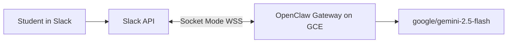

# OpenClaw on GCP — demo of work so far

End-to-end runbook for **what is implemented today**: a **personal agent via Slack** — OpenClaw gateway on GCE (Stage 1) and **Slack Socket Mode + Gemini** (Stage 2). Product definition: [`PRODUCT.md`](PRODUCT.md). **Stage 2 demo script:** [`docs/PHASE1_DEMO.md`](docs/PHASE1_DEMO.md). **Stage 3 persona:** [`docs/PERSONAL_AGENT.md`](docs/PERSONAL_AGENT.md). Fixes: [`docs/TROUBLESHOOTING.md`](docs/TROUBLESHOOTING.md). Ops: [`RUNBOOK.md`](RUNBOOK.md); evidence: [`journal.md`](journal.md).

**Working directory for GCP commands:** `experiments/openclaw-google/gcp/`

---

## What exists today

| Piece | Status | Demoable? |
|-------|--------|-----------|
| **GCE VM** `openclaw-gateway` | Phase 0 hardened; OpenClaw **2026.5.19** on disk | Yes — start VM, `/healthz`, Control UI via tunnel |
| **Slack (Socket Mode)** | Phase 1 **complete** — `@mention` → bot reply (Gemini) | Yes — live Slack demo per [`docs/PHASE1_DEMO.md`](docs/PHASE1_DEMO.md) |
| **LLM on VM** | Default **`google/gemini-2.5-flash`** + `GEMINI_API_KEY` | Yes — `models status` on VM |
| **GCP bash helpers** | `gcp/scripts/*`, `gcp/vm/*` | Yes — start/stop, ssh, tunnel, setup scripts |



---

## Current GCP snapshot (update when you change infra)

| Resource | Project | Typical state | Notes |
|----------|---------|---------------|--------|
| `openclaw-gateway` | `REDACTED-gcp-project` | Start with `./scripts/start-vm.sh` if stopped | Slack + config persist on disk |
| `openclaw-google-starter` | same | Cloud Run deployed, scales to **zero** when idle | Not the OpenClaw gateway |
| `ollama-l4` | same | TERMINATED | Unrelated sandbox |

Record changes in [`journal.md`](journal.md) after demos or teardown.

---

## Prerequisites

| Requirement | Notes |
|-------------|--------|
| `gcloud` CLI | Authenticated (`gcloud auth login`) |
| [`gcp/phase0.env`](gcp/phase0.env) | Copy from [`gcp/phase0.env.example`](gcp/phase0.env.example); gitignored |
| Permissions | Compute Engine SSH + instance start/stop on the project |
| Secrets | Gateway token and API keys live **on the VM only** — never commit or paste into this repo |

---

## Demo 1 — Phase 0: OpenClaw gateway on GCE (main path)

Shows the **vendor GCE + Docker** deployment: health endpoint and Control UI.

### 1.1 Start the VM (if stopped)

```bash
cd experiments/openclaw-google/gcp
./scripts/start-vm.sh
./scripts/describe-vm.sh
```

Wait until status is **RUNNING** (SSH may take ~30s after boot).

### 1.2 Health smoke (no browser)

```bash
./scripts/vm-exec.sh curl -sS -i http://127.0.0.1:18789/healthz
```

**Expected:** `HTTP/1.1 200` and body `{"ok":true,"status":"live"}`.

If connection refused, wait and retry (gateway container still starting).

### 1.3 Control UI (operator)

Terminal A (blocks until Ctrl+C):

```bash
./scripts/ssh-tunnel.sh
```

On the VM (one-time read of token name only in docs):

```bash
./scripts/vm-exec.sh bash -lc 'grep OPENCLAW_GATEWAY_TOKEN= ~/openclaw/.env | sed "s/=.*/=***/"'
```

Copy the **real** token value from the VM via SSH if needed; paste into the browser when prompted.

Terminal B — open:

`http://127.0.0.1:18789/`

**Expected:** OpenClaw Control UI loads when the token is valid.

### 1.4 Stop the VM (save compute)

```bash
./scripts/stop-vm.sh
```

Disk and config persist; only vCPU/RAM billing stops.

---

## Demo 2 — Phase 1 prep (on a running VM)

Shows work done toward Slack **before** tokens exist. Requires Demo 1.1 (VM running).

### 2.1 OpenClaw version and Slack plugin

```bash
./scripts/vm-exec.sh bash -s <<'EOF'
ROOT="$HOME/openclaw"
sudo docker compose -f "$ROOT/docker-compose.yml" --project-directory "$ROOT" \
  run --rm openclaw-cli openclaw --version
ls -la "$HOME/.openclaw/slack.socket.patch.json5" 2>/dev/null || echo "patch missing"
EOF
```

**Expected:** Version **≥ 2026.5.12** (repo prep used **2026.5.19**); patch file present if prep ran.

### 2.2 Model auth (Gemini)

```bash
./scripts/vm-exec.sh bash -s <<'EOF'
ROOT="$HOME/openclaw"
sudo docker compose -f "$ROOT/docker-compose.yml" --project-directory "$ROOT" \
  run --rm openclaw-cli models status 2>&1 | head -30
EOF
```

**Expected:** **Default:** `google/gemini-2.5-flash`; `google` usable via `GEMINI_API_KEY` (values redacted).

### 2.3 Negative check (Slack not configured yet)

Without `SLACK_APP_TOKEN` / `SLACK_BOT_TOKEN` in VM `.env`:

```bash
./scripts/vm-exec.sh bash -s <<'EOF'
ROOT="$HOME/openclaw"
sudo docker compose -f "$ROOT/docker-compose.yml" --project-directory "$ROOT" \
  run --rm openclaw-cli config patch --file /home/node/.openclaw/slack.socket.patch.json5 --dry-run 2>&1 | tail -5
EOF
```

**Expected:** `SecretRefResolutionError` for missing `SLACK_*` env vars — proves patch is waiting on tokens.

---

## Demo 3 — Phase 1: Slack happy path (primary product demo)

**Presenter script:** [`docs/PHASE1_DEMO.md`](docs/PHASE1_DEMO.md) (recommended for talks).

**Live steps:**

1. Ensure VM is running (`./scripts/start-vm.sh` if needed).
2. In an invited channel: `@OpenClaw hello` → expect bot reply (first message may be a generic “came online” opener — normal).
3. Follow-up in thread: `In one sentence, what can you help with?` → expect contextual answer.
4. Optional operator terminal: gateway logs show `socket mode connected` and `agent model: google/gemini-2.5-flash`.

**Troubleshooting / backstory:** [`docs/TROUBLESHOOTING.md`](docs/TROUBLESHOOTING.md).

**First-time setup (not a repeat demo):** [`docs/SLACK_APP_WALKTHROUGH.md`](docs/SLACK_APP_WALKTHROUGH.md) + `./vm/setup-slack-socket.sh`.

---

## Repo artifacts to point at in a presentation

| Artifact | What it shows |
|----------|----------------|
| [`gcp/scripts/`](gcp/scripts/) | API enable, VM lifecycle, SSH tunnel, `vm-exec` |
| [`gcp/vm/onboard-noninteractive-local.sh`](gcp/vm/onboard-noninteractive-local.sh) | Phase 0 hardening (`gateway.mode=local`) |
| [`gcp/vm/setup-slack-socket.sh`](gcp/vm/setup-slack-socket.sh) | Phase 1 automation (tokens required) |
| [`docs/TROUBLESHOOTING.md`](docs/TROUBLESHOOTING.md) | Recovery and symptom → fix table |
| [`PRODUCT.md`](PRODUCT.md) | Product vision and milestones |
| [`docs/PERSONAL_AGENT.md`](docs/PERSONAL_AGENT.md) | Demo prompt pack (Product P1+) |
| [`docs/PHASE1_DEMO.md`](docs/PHASE1_DEMO.md) | Phase 1 live demo script |
| [`archive/MANIFEST.md`](archive/MANIFEST.md) | Historical Cloud Run lab track (archived) |

---

## Suggested demo script (5–10 minutes)

**Personal agent narrative (recommended):**

1. **Context** — Students use **Slack only**; personal web-assistant behavior on a private GCE gateway ([`PRODUCT.md`](PRODUCT.md)).
2. **Start VM** — `./scripts/start-vm.sh` + `describe-vm.sh`.
3. **Prove gateway** — `curl …/healthz` → 200 (optional: `ssh-tunnel.sh` 30s).
4. **Live Slack** — `@OpenClaw hello` + one follow-up (see [`docs/PHASE1_DEMO.md`](docs/PHASE1_DEMO.md)).
5. **Optional (Product P1+)** — Run a demo prompt from [`docs/PERSONAL_AGENT.md`](docs/PERSONAL_AGENT.md) § Demo prompt pack.
6. **Stop VM** — `./scripts/stop-vm.sh`.
7. **Q&A** — Product P1 persona; RUNBOOK Phase 2 hardening; [`docs/TROUBLESHOOTING.md`](docs/TROUBLESHOOTING.md) for recovery.

**Phase 1 infra only:** follow [`docs/PHASE1_DEMO.md`](docs/PHASE1_DEMO.md).

---

## Not in scope for this demo

- HTTP Request URL Slack mode (public webhook + signing secret)
- RUNBOOK Phase 2 (timeouts, abuse tests) / Phase 3 (cost dashboards, triage)
- Production firewall / IAP hardening (recommended before students; see [Gateway security](https://docs.openclaw.ai/gateway/security))

---

## Related docs

| Doc | Use |
|-----|-----|
| [`README.md`](README.md) | Index |
| [`RUNBOOK.md`](RUNBOOK.md) | Phases 0–3 definition of done |
| [`journal.md`](journal.md) | Dated evidence |
| [`docs/PHASE1_DEMO.md`](docs/PHASE1_DEMO.md) | Phase 1 presenter script |
| [`docs/SLACK_APP_WALKTHROUGH.md`](docs/SLACK_APP_WALKTHROUGH.md) | Slack app creation |
| [`docs/TROUBLESHOOTING.md`](docs/TROUBLESHOOTING.md) | Recovery / troubleshooting |
